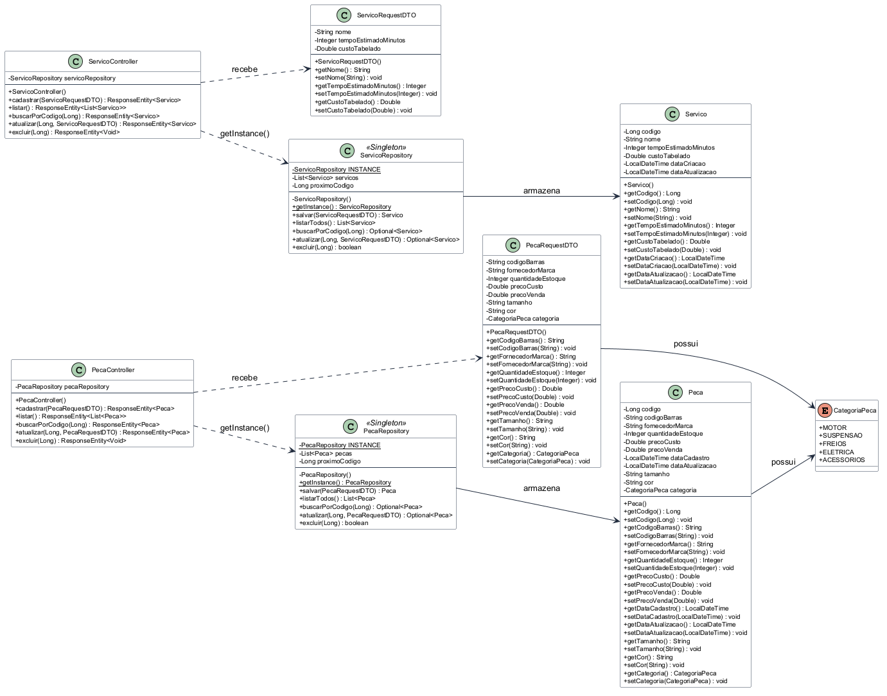

# MecaniQA — API (OAT 1, OAT 2 e OAT 3)

> **Equipe:** São Luiz  
> **Disciplina:** Desenvolvimento Web Orientado a Objetos (UniFTC)  
> **Professor / Avaliador:** Prof. Lucas Almeida Silva (`lasilva`)  
> **Prazo do Entregável Técnico da OAT 3:** 25/10/2026<br>
> **Prazo da Apresentação da OAT 3:** até 18/11/2026

---

## Sobre o Projeto

A **MecâniQA API** é uma solução de backend desenvolvida com **Java e Spring Boot** para o gerenciamento de catálogos de autopeças e tabelas de serviços automotivos.

Na **OAT 1**, os registros eram armazenados em memória. Na **OAT 2**, foram acrescentados os fluxos de ordens de serviço e pedidos de peças. Na **OAT 3**, a persistência passou a utilizar **MySQL com JDBC nativo e SQL manual**, mantendo os modelos, os DTOs e os endpoints das etapas anteriores.

---

## Histórico da OAT 1 — Restrições Arquiteturais e Decisões de Engenharia

- **Persistência em memória na OAT 1:** A primeira entrega não utilizava banco de dados físico. Esse comportamento foi substituído pela persistência MySQL na OAT 3.
- **Isolamento de Injeção de Dependência:** Proibido o uso de `@Autowired`, `@Component` ou `@Repository` gerenciados pelo framework Spring nos repositórios.
- **Padrão de Projeto Singleton Manual:** Classes de repositório (`PecaRepository` e `ServicoRepository`) implementadas com construtor `private`, atributo `private static NomeRepository INSTANCE` e método de acesso global `public static synchronized NomeRepository getInstance()`.
- **Controle de Concorrência (Thread-Safety):** Métodos de escrita, geração sequencial de identificadores e mutação de listas internas utilizam o modificador `synchronized`.
- **Semântica REST com `ResponseEntity`:** Todos os métodos dos controladores manipulam explicitamente os códigos de status HTTP (`201 Created`, `200 OK`, `204 No Content` e `404 Not Found`).
- **Isolamento de Entrada com DTOs:** Uso de `PecaRequestDTO` e `ServicoRequestDTO` para receber dados externos sem expor atributos de controle gerados pela aplicação (`codigo`, `dataCadastro`, `dataCriacao` e `dataAtualizacao`).

---

## Persistência na OAT 3

- Banco de dados: **MySQL**, com criação das cinco tabelas em `sql/mecaniqa.sql`.
- Acesso aos dados: **JDBC nativo**, com comandos SQL escritos manualmente e interface `Repository<T, ID>` fornecida pelo professor.
- Os Controllers chamam a camada Service; as operações SQL ficam nos Repositories.
- A aplicação lê `DB_URL`, `DB_USER` e `DB_PASSWORD` das variáveis de ambiente. As credenciais não devem ser versionadas.

### Configuração local

1. Inicie o MySQL e execute `sql/mecaniqa.sql` para criar o banco e suas tabelas.
2. **Somente se o banco já tiver sido criado com a chave composta antiga**, execute uma vez `sql/migracao-itens-pedido-peca.sql`. A migração permite adicionar a mesma peça mais de uma vez ao pedido, como na OAT 2. Não execute essa migração em uma instalação nova, que já usa o script atualizado.
3. Configure as variáveis de ambiente com os dados do seu MySQL e execute `./gradlew bootRun`.

```bash
export DB_URL='jdbc:mysql://127.0.0.1:3306/mecaniqa'
export DB_USER='usuario_do_mysql'
export DB_PASSWORD='senha_local'
./gradlew bootRun
```

### Testes automatizados

Execute `./gradlew test` (`.\gradlew.bat test` no Windows). Com Docker disponível,
o Testcontainers inicia um MySQL temporário e executa o CRUD completo dos repositórios.
Sem Docker, os testes unitários são executados e somente a integração MySQL é ignorada.

## Diagrama de Classes UML

O modelo estrutural de classes da API MecâniQA foi projetado em conformidade com as diretrizes do Barema Oficial:



Arquivos de especificação:

- PlantUML: [`docs/diagrama-classes.puml`](docs/diagrama-classes.puml)
- Mermaid.js: [`docs/diagrama-classes.md`](docs/diagrama-classes.md)

---

## Mapeamento de Endpoints (User Stories US01 a US08)

### Catálogo de Peças (`/api/pecas`)

| Método   | Endpoint              |            Status HTTP             | Descrição / User Story                                   |
| :------- | :-------------------- | :--------------------------------: | :------------------------------------------------------- |
| `POST`   | `/api/pecas`          |           `201 Created`            | **US01:** Cadastrar nova peça com categoria vinculada    |
| `GET`    | `/api/pecas`          |              `200 OK`              | **US02:** Listar todas as peças cadastradas              |
| `GET`    | `/api/pecas/{codigo}` |     `200 OK` / `404 Not Found`     | **US02:** Buscar peça pelo código identificador          |
| `PUT`    | `/api/pecas/{codigo}` |     `200 OK` / `404 Not Found`     | **US03:** Atualizar dados, estoques e preços de uma peça |
| `DELETE` | `/api/pecas/{codigo}` | `204 No Content` / `404 Not Found` | **US04:** Excluir registro de peça do catálogo           |

### Tabela de Serviços (`/api/servicos`)

| Método   | Endpoint                 |            Status HTTP             | Descrição / User Story                              |
| :------- | :----------------------- | :--------------------------------: | :-------------------------------------------------- |
| `POST`   | `/api/servicos`          |           `201 Created`            | **US05:** Cadastrar novo serviço automotivo         |
| `GET`    | `/api/servicos`          |              `200 OK`              | **US06:** Listar todos os serviços disponíveis      |
| `GET`    | `/api/servicos/{codigo}` |     `200 OK` / `404 Not Found`     | **US06:** Buscar serviço por código identificador   |
| `PUT`    | `/api/servicos/{codigo}` |     `200 OK` / `404 Not Found`     | **US07:** Atualizar tempo estimado e custo tabelado |
| `DELETE` | `/api/servicos/{codigo}` | `204 No Content` / `404 Not Found` | **US08:** Excluir serviço do portfólio              |

---

## Gestão Ágil do Projeto (Metodologia SCRUM / Kanban)

O ciclo de vida da sprint, o refinamento das User Stories e a esteira de Pull Requests foram planejados e acompanhados através do quadro oficial no Trello:

- **Quadro Kanban Oficial:** [Trello — MecâniQA São Luiz](https://trello.com/invite/b/6a81b5f9b503ae18be6d37dd/ATTI6238f37729b12c6eee23844d4da9c17139389109/mecaniqa-api-sao-luiz)

---

## Execução do Projeto

### Pré-requisitos

- Java JDK 21 instalado (versão configurada no Gradle).
- Gradle Wrapper (incluso no projeto).

### Comandos de Inicialização

1. Clonar o repositório oficial:
   ```bash
   git clone https://github.com/hellennverenaa/mecaniQA-api-sao-luiz.git
   cd mecaniQA-api-sao-luiz
   ```
